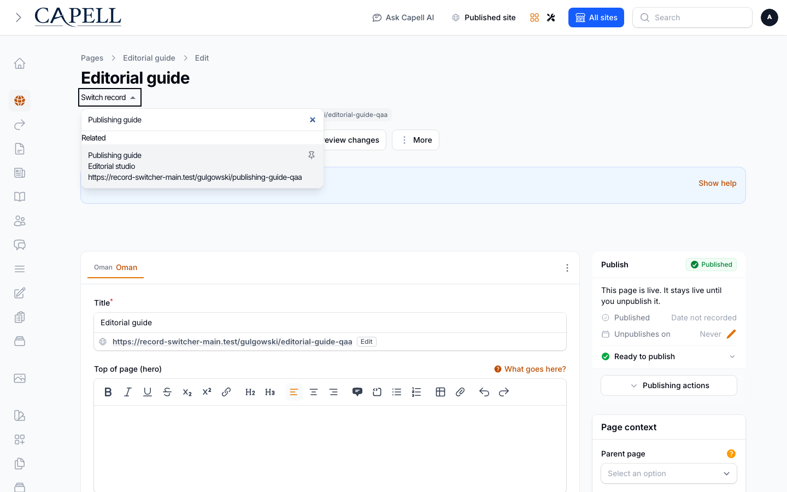
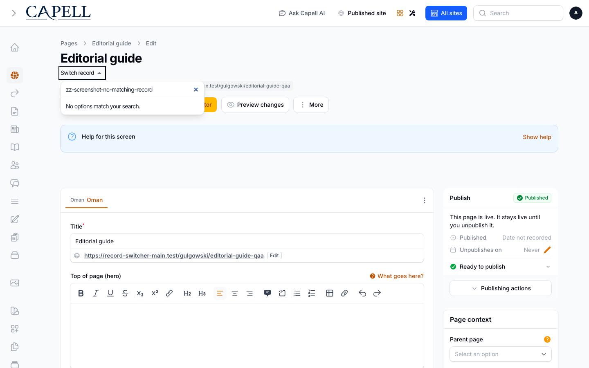

# Record Switcher

<!-- prettier-ignore-start -->

Type a few letters in the Switch record menu under the title of a page edit screen to jump to another page. You don't need to go back to the page tree. The same menu appears when you edit a layout, a site, a section, a widget or a menu, and lists others of that kind. It works with Capell Admin and has nothing to set up or switch on.

For pages, suggestions come in three groups. Related pages that share a site and a parent come first, then other pages on this site, then pages on other sites. Typing narrows the list by page name, parent names or public address. Every result shows its site and address, so two pages with the same name are easy to tell apart. For the other kinds, the most recently updated come first. Either way, ten results show at a time, and arrow keys and Enter choose one.

Save before you switch, because the menu doesn't save the item you're leaving. Once you save, the title above the menu updates to the new name. You only see items you're allowed to edit, and the menu stays hidden when there's nothing else to switch to. Pick a result and its edit screen opens, ready for your next change.

- **Price and availability:** Check current availability and price on the [Capell Marketplace listing](https://capell.app/marketplace/extensions/record-switcher).
- **Licence:** Check the licence terms on the [Capell Marketplace listing](https://capell.app/marketplace/extensions/record-switcher).
- **Requires:** `PHP ^8.4`, `capell-app/admin ^1.0.66`, `capell-app/core ^1.0.75`, `filament/filament ^5.7.6`, `laravel/framework ^12.61.1|^13.12.0`, `livewire/livewire ^3.0|^4.0`, `spatie/laravel-package-tools ^1.15`.
- **Install:** `composer require capell-app/record-switcher`.

## Quick Start

1. Install the package: `composer require capell-app/record-switcher`.
2. Open the package admin surface at `/admin/pages` and confirm Record Switcher is available.

## For Developers

A focused query Action builds authorised labels and URLs, keeping resource discovery and option construction outside the heading extension.

## Configure

This extension works without configuration. There is nothing to set after install.

## Limits And Pitfalls

- Install the required Capell packages at the versions in `composer.json`: `capell-app/admin ^1.0.66`, `capell-app/core ^1.0.75`.
- Run migrations before opening package resources or public routes.

## Screens And Workflow

- Record Switcher admin heading suggestions (admin).
- Record Switcher empty search state (admin).
- Record Switcher cross-site page suggestions (admin).

## Install Impact

- Required packages: `capell-app/admin`, `capell-app/core`.
- Admin navigation: no admin page or resource contribution is declared.
- Admin/editor extensions: none declared.
- Permissions: no package permission declarations or Shield gates detected; host access rules still apply.
- Public routes: none declared.
- Database changes: package migrations are declared.
- Config: no package config files.
- Settings: no package settings declared.
- Queues or schedules: none declared.
- Cache tags: none declared.
- Commands: none declared.

## Troubleshooting

| Symptom | Likely cause | Check | Fix |
| --- | --- | --- | --- |
| Package surface is missing after install | Provider or manifest is not loaded | Confirm `capell.json`, package `composer.json`, and provider registration | Reinstall the package, refresh Composer autoload, and clear host caches |
| Admin screen or command fails on missing table | Package migrations have not run | Check the tables listed in `Data Model` | Run host migrations and rerun the focused package test |

## Upgrading

No manual steps between minor versions.

Read [CHANGELOG.md](CHANGELOG.md) before upgrading.

## Next Steps

- [Package docs](docs/README.md)
- [Overview](docs/overview.md)
- [Troubleshooting](#troubleshooting)
- [Developer reference](docs/reference.md)
- [Marketplace assets](docs/assets/marketplace/)
- [Capell content language plan](../../docs/CONTENT_LANGUAGE_PLAN.md)
- [Capell documentation design system](../../docs/DESIGN_SYSTEM.md)
- [Capell and package ERD notes](../../docs/erd/capell-and-package-erds.md)

<!-- prettier-ignore-end -->
