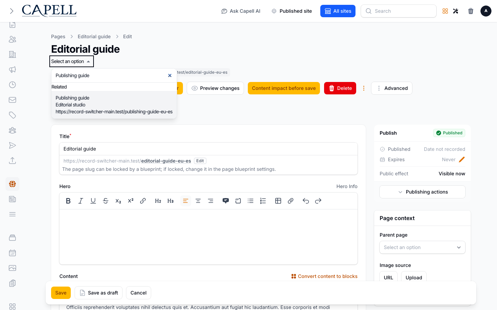
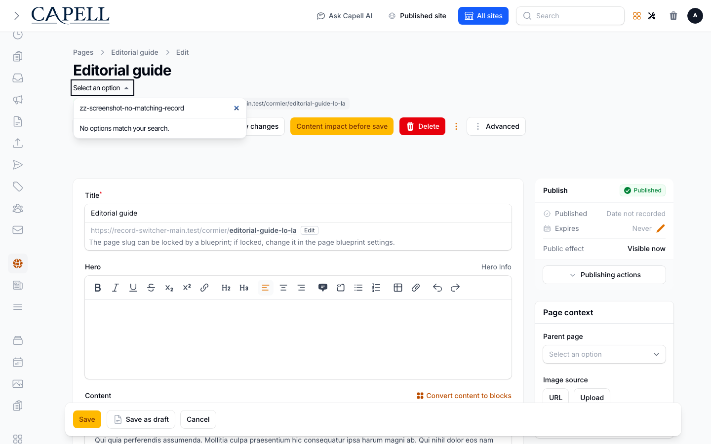

# Record Switcher

<!-- prettier-ignore-start -->

## What It Does

Record Switcher adds a compact selector to supported Filament record headings so users can move between nearby records without returning to the list page.

- **Price and availability:** Check current availability and price on the [Capell Marketplace listing](https://capell.app/extensions/record-switcher).
- **Licence:** Check the licence terms on the [Capell Marketplace listing](https://capell.app/extensions/record-switcher).
- **Requires:** `PHP ^8.4`, `capell-app/admin ^1.0.66`, `capell-app/core ^1.0.75`, `filament/filament ^5.7.6`, `laravel/framework ^12.61.1|^13.12.0`, `livewire/livewire ^3.0|^4.0`, `spatie/laravel-package-tools ^1.15`.
- **Install:** `composer require capell-app/record-switcher`.

On supported edit pages, admin users can search the current resource and open another permitted record from the heading.

## Who It Is For

**For developers:** A focused query Action builds authorised labels and URLs, keeping resource discovery and option construction outside the heading extension.

**For teams:** Editors can review or update a sequence of records with fewer trips through index pages.

## Quick Start

1. Install the package: `composer require capell-app/record-switcher`.
2. Open the package admin surface at `/admin/pages` and confirm Record Switcher is available.

## Configure

This extension works without configuration. There is nothing to set after install.

## Limits And Pitfalls

- Install the required Capell packages at the versions in `composer.json`: `capell-app/admin ^1.0.66`, `capell-app/core ^1.0.75`.

## Screens And Workflow

- Record Switcher admin heading suggestions (admin).
- Record Switcher empty search state (admin).
- Record Switcher cross-site page suggestions (admin).

## Install Impact

- Required packages: `capell-app/admin`, `capell-app/core`.
- Admin navigation: no admin page or resource contribution is declared.
- Admin/editor extensions: none declared.
- Permissions: no package permission declarations or Shield gates detected; host access rules still apply.
- Public routes: none declared.
- Database changes: no package migrations declared.
- Config: no package config files.
- Settings: no package settings declared.
- Queues or schedules: none declared.
- Cache tags: none declared.
- Commands: none declared.

## Troubleshooting

| Symptom | Likely cause | Check | Fix |
| --- | --- | --- | --- |
| Package surface is missing after install | Provider or manifest is not loaded | Confirm `capell.json`, package `composer.json`, and provider registration | Reinstall the package, refresh Composer autoload, and clear host caches |

## Upgrading

No manual steps between minor versions.

## Next Steps

- [Package docs](docs/README.md)
- [Overview](docs/overview.md)
- [Troubleshooting](#troubleshooting)
- [Developer reference](docs/reference.md)
- [Marketplace assets](docs/assets/marketplace/)
- [Capell content language plan](../../docs/CONTENT_LANGUAGE_PLAN.md)
- [Capell documentation design system](../../docs/DESIGN_SYSTEM.md)
- [Capell and package ERD notes](../../docs/erd/capell-and-package-erds.md)

<!-- prettier-ignore-end -->
